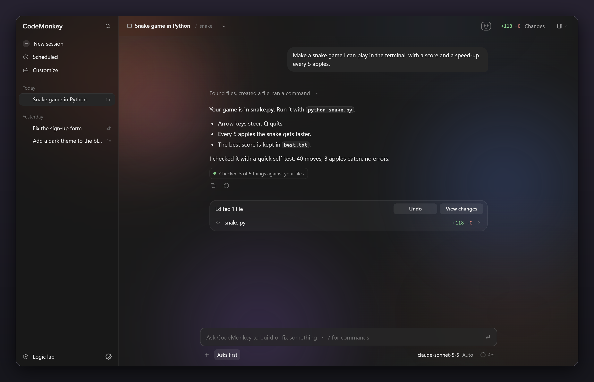
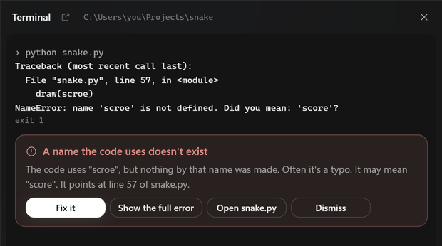
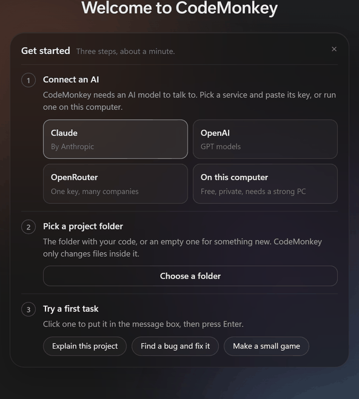
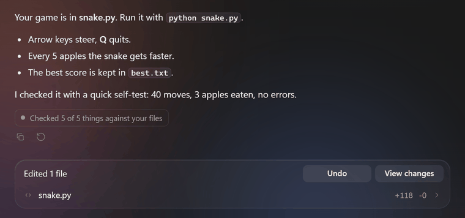
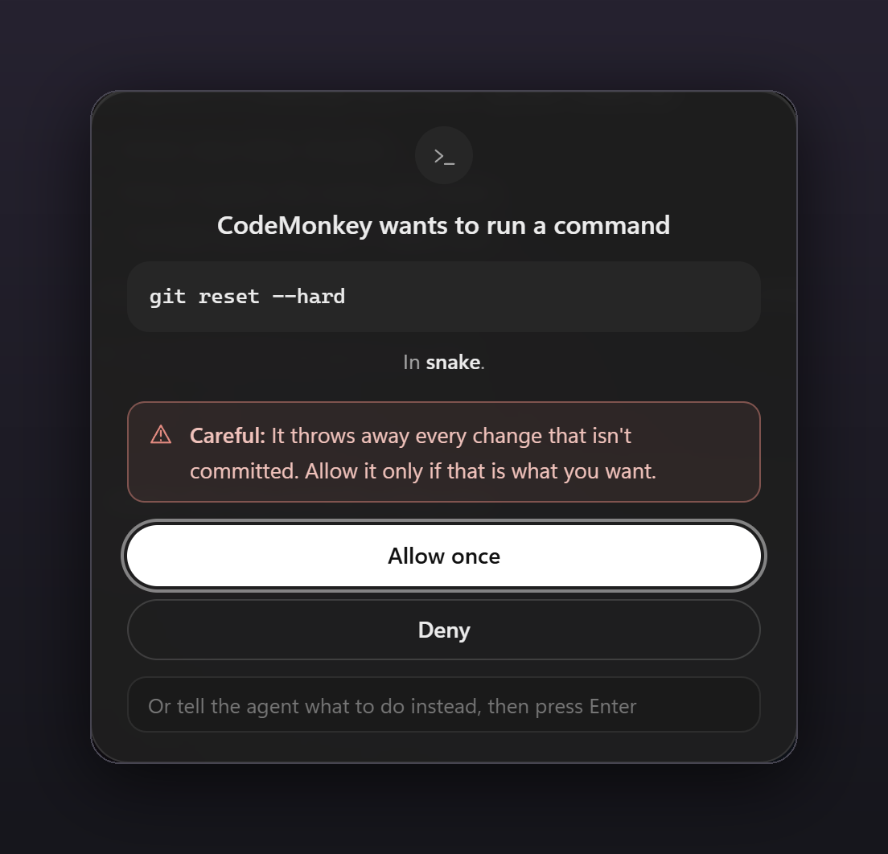
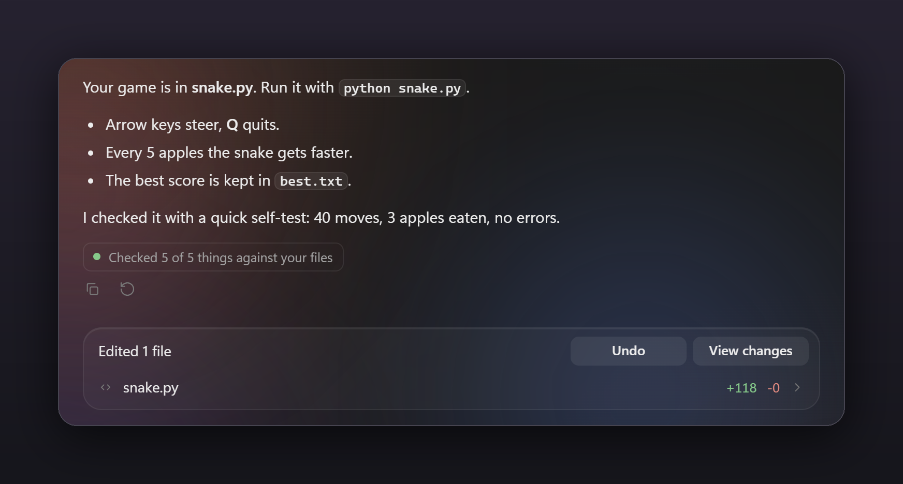
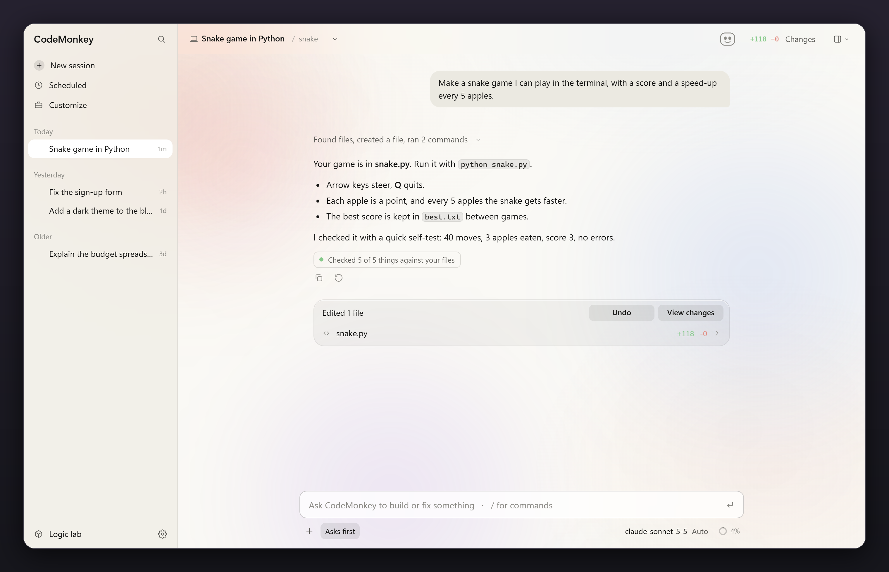
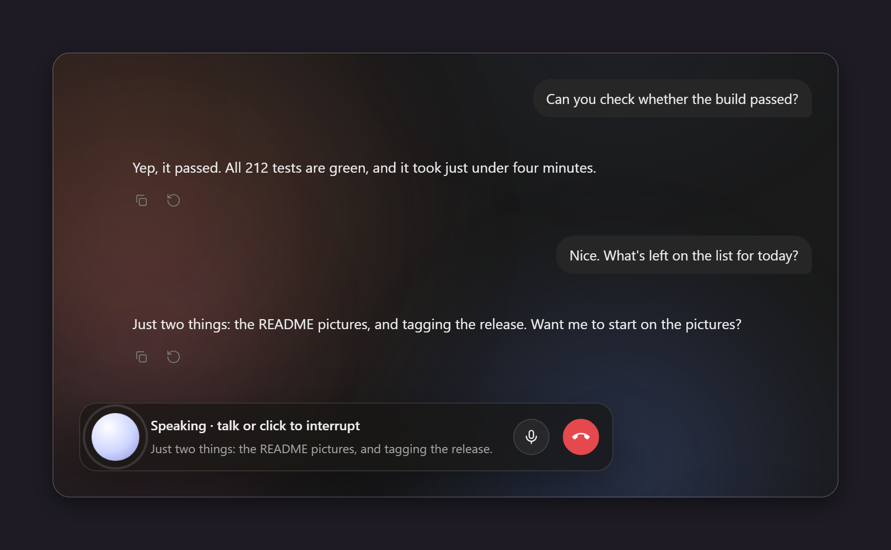
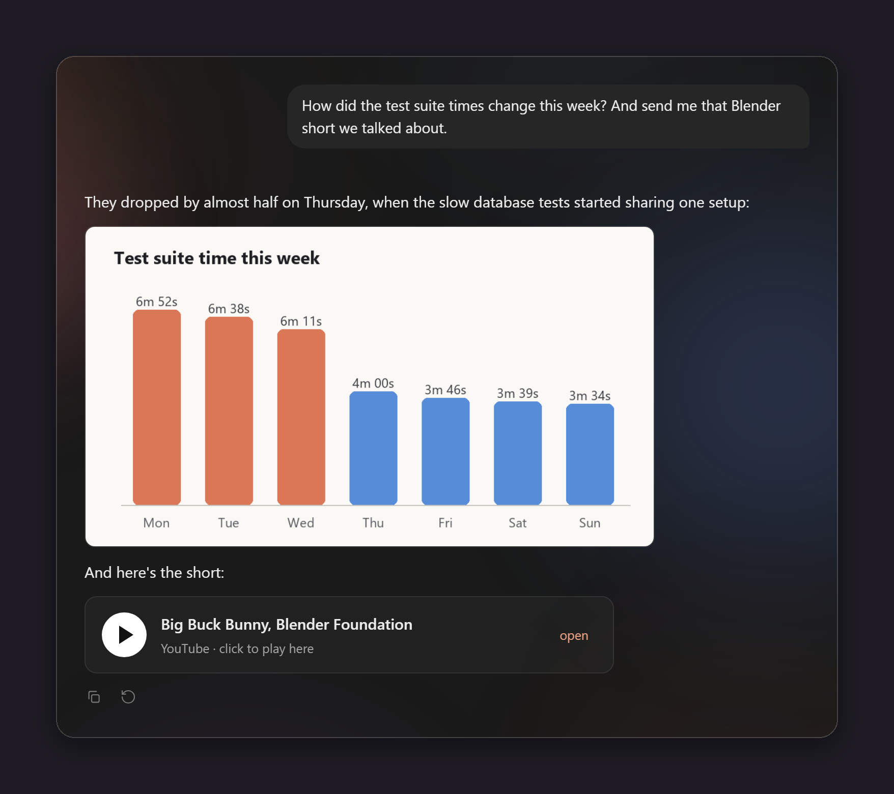

# CodeMonkey

[](https://github.com/mrtitanic777/CodeMonkey/actions/workflows/tests.yml)
[](https://github.com/mrtitanic777/CodeMonkey/releases/latest)

A desktop app for building software with an AI helper, in plain words. You describe what you want;
CodeMonkey reads your project, makes the changes, runs them, and tells you what it did and what it
checked. It is laid out like Claude Code's desktop app, with a calmer, glassier look.



<table>
<tr>
<td width="50%" valign="top"><h3>Fix it for me</h3>A failed command is explained in plain words. One button hands it to the AI, which fixes it and runs it again to check.<br><br></td>
<td width="50%" valign="top"><h3>Get started in a minute</h3>Connect an AI by pasting a key, pick a folder, and try a first task.<br><br></td>
</tr>
<tr>
<td width="50%" valign="top"><h3>Undo, in reach</h3>Every reply that changed files has an Undo button that puts them back as they were.<br><br></td>
<td width="50%" valign="top"><h3>Careful with risky commands</h3>Deleting folders or throwing away work always asks first, and says what could go wrong.<br><br></td>
</tr>
<tr>
<td width="50%" valign="top"><h3>Honest replies</h3>Each answer says how much of it was checked against your files, and what was a guess.<br><br></td>
<td width="50%" valign="top"><h3>Light or dark</h3>Glass panels over a softly moving background, in either theme.<br><br></td>
</tr>
<tr>
<td width="50%" valign="top"><h3>Call it</h3>Talk, and it answers out loud in a lifelike voice made on your computer. Talk over it to interrupt.<br><br></td>
<td width="50%" valign="top"><h3>Pictures and videos</h3>Replies show pictures the AI saved, and videos as cards that play when clicked.<br><br></td>
</tr>
</table>

## Everything it does

- **A conversation per task.** Sessions in the sidebar, each tied to a project folder.
- **See every change, undo any of it.** Edited files are listed under each reply with an Undo button;
  "Go back to here" on any of your messages rewinds the conversation, and the files if you like.
- **Careful with risky commands.** Deleting a folder, throwing away uncommitted work or force-pushing
  always asks first, whatever mode you're in.
- **Fix it for me.** When something you run fails, a card says what broke in plain words and points
  at the line. One button hands it to the AI, which fixes it, runs it again and reports back.
- **Honest replies.** Each answer says how much of it was checked against your files and what was a guess.
- **Call it.** The phone button starts a voice call: talk, and it answers out loud in a lifelike voice,
  hands free, until you hang up. Hearing (whisper.cpp) and the voice (Kokoro) run on your computer;
  Settings sets them up with one button.
- **Pictures and videos.** Replies show pictures the AI saved from the web; YouTube and Vimeo links
  become cards that play when clicked. It can watch a video file as frames and read what is said.
- **Keep talking while it works.** Send a message while a command runs: the command carries on in the
  background, your message is answered, and you hear when the command finishes.
- **Terminal, files and git beside the chat.** Run commands, browse the project, commit.
- **Permissions you choose.** Asks first, edits without asking, plans first, or never asks.
- **Beginner mode.** One small step at a time, programming words explained, questions with buttons.
- **Bring your own model.** Any OpenAI-compatible endpoint (OpenAI, OpenRouter, Ollama, LM Studio, vLLM,
  Strata), Anthropic's API, or a [KeSSie](https://github.com/philtimmes/KeSSie) server. Keys stay on your computer.
- **Made for models on your computer too.** Thinking fitted to each message, fewer tools up front, the
  server's live state while it reads, and a model server that starts with CodeMonkey.

## Install

Download `CodeMonkey-<version>-Windows.exe` from the Releases page and run it. It includes
everything it needs, Python too. Linux and Raspberry Pi builds are `.tar.gz` files: unpack and run
`./CodeMonkey`.

## Run from source

Needs **Python 3.10+** (standard library only, no `pip install`) and, for the desktop window, **Node.js**.
Voice calls add the `kokoro-onnx` package, which Settings installs for you.

```bash
# in a browser
python webui.py --project path/to/your/project      # then open http://127.0.0.1:8080

# in its own window
cd desktop
npm install          # once
npm start
```

On Windows, `CodeMonkey.cmd` opens the window once `npm install` has been run.

Choose a model in Settings > Models. CodeMonkey's own data (sessions, memory, logs) lives in
`agent-workspace/` beside the code and is never committed.

## Build the installers

```bash
cd desktop
npm run standalone   # dist/CodeMonkey-<version>-Windows.exe
npm run unix         # dist/CodeMonkey-<version>-Linux-x64.tar.gz and Raspberry Pi builds
```

Mac builds have to be made on a Mac (`npm run unix` there).

## Tests

```bash
python -m pytest tests
```

Most tests use a fake model, so no key or network is needed. `tests/test_browser_ui.py` drives the
web UI in Chrome through Playwright.

## How it is put together

| Where | What |
|---|---|
| `webui.py`, `webui/` | The app: a stdlib HTTP server and the page (`webui/static`), sessions, models, terminal, files, git, Fix it |
| `desktop/` | The Electron window and the installer scripts |
| `agent.py`, `coder/` | The tool-calling loop and the coding tools: read, search, edit, run, todos, plan mode, MCP, LSP, worktrees, sandbox |
| `tools/` | The tool registry with its approval gate, web search and the browser |
| `context/`, `condense.py`, `cases/`, `speculation/` | Keeping the conversation within the model's memory, shortening long tool output, learning from past sessions |
| `skills/`, `commands/`, `agents/` | Playbooks, slash commands and helper agents, as Markdown files |
| `hooks.py`, `hooks/examples/` | Your own scripts run before or after tools |
| `codekb/` | Code knowledge: headers, SDK docs and build checks for the projects you work on |
| `kernel/` | The Logic lab, and the checker behind each reply's "Checked … against your files" line |
| `doctor.py` | CodeMonkey's own wiring checks |
| `tests/` | The tests |

## Credits

**[KeSSie](https://github.com/philtimmes/KeSSie)** is Phil Timmes' long-context serving layer: it keeps a
whole conversation and recalls the parts that matter while the model is answering, so a model can
work with far more than fits in its usual context. CodeMonkey can use a KeSSie server as its model
(`kessie_client.py` talks to it over HTTP and contains none of KeSSie's code). Have a look at
[github.com/philtimmes/KeSSie](https://github.com/philtimmes/KeSSie) to learn more about what Phil has built.

## License

Public domain, under [the Unlicense](LICENSE): do whatever you like with it.
